# Visueller Qualitätsbericht – Grafik-Neuaufbau (Version 0.2.0)

Dieser Bericht dokumentiert, was ersetzt wurde, wie es geprüft wurde und wo die Grafik noch Schwächen hat.
Stilregeln: [ART_BIBLE.md](ART_BIBLE.md) · Pipeline: [ASSET_PIPELINE.md](ASSET_PIPELINE.md) · vollständiger Katalog: [ASSETS.md](ASSETS.md).

## 1. Vorher / Nachher

| Vorher (0.1.0) | Nachher (0.2.0) |
|---|---|
| 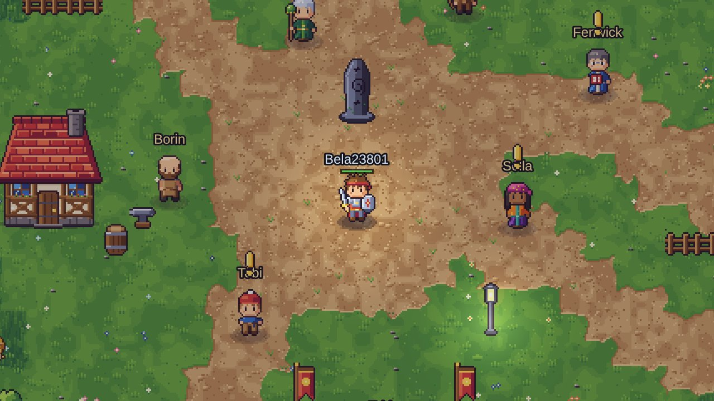 | 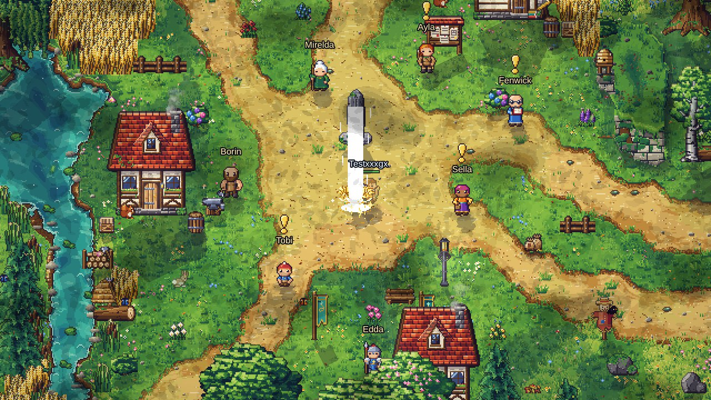 |
| 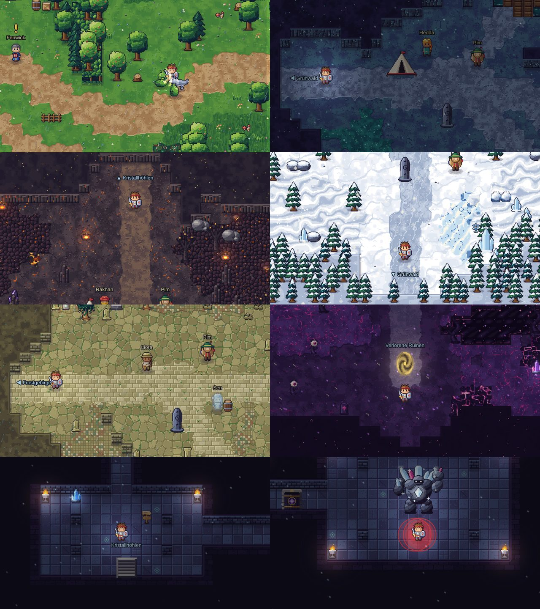 | siehe Abschnitt 2 |

Die wichtigsten Unterschiede: größeres Sichtfeld mit kleiner Figur in großer Welt, gemalter Boden ohne Kachelraster,
Bäume mit bis zu sechs Kacheln Kronenbreite, Bach mit Böschung und Brücken, Schlagschatten, farbiges Licht.

## 2. Vergleichsaufnahmen aus dem laufenden Spiel

| Gebiet | Aufnahme |
|---|---|
| Grünwald, Dorf Quellhain (Tag) |  |
| Grünwald (Nacht, Laternen- und Spielerlicht) | 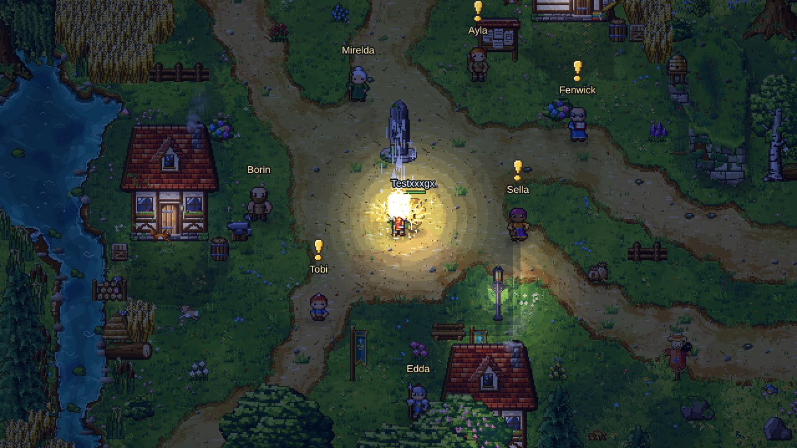 |
| Wurzelgruft (Dungeon) | 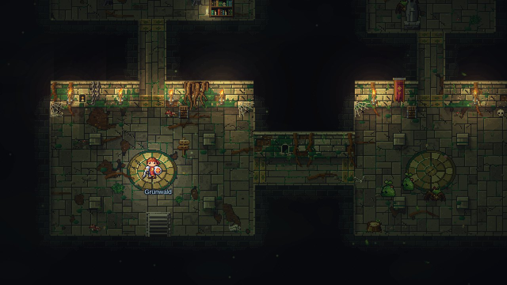 |
| Kristallhöhlen | 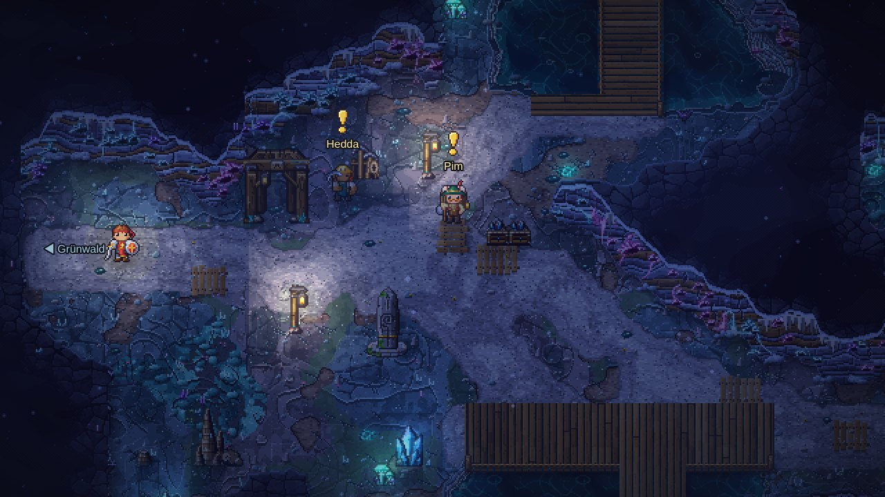 |
| Glutlande | 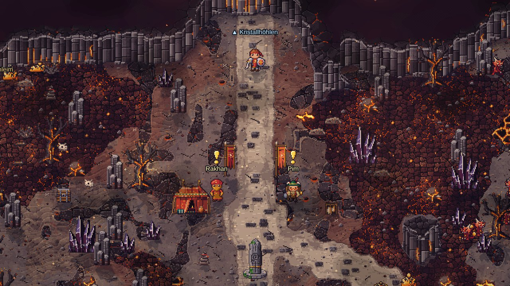 |
| Frostgebirge | 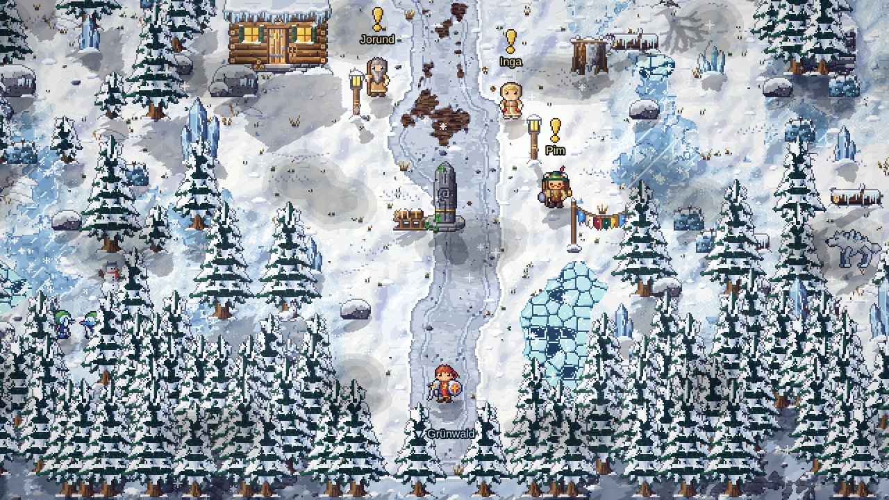 |
| Verlorene Ruinen | 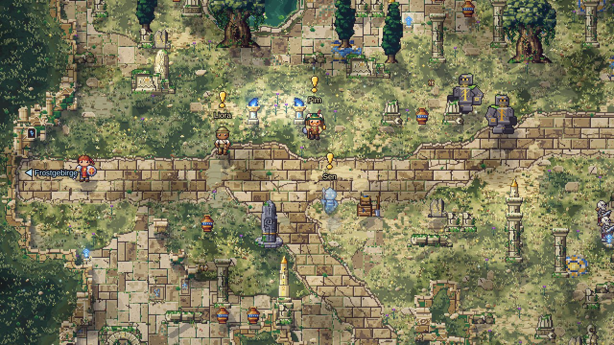 |
| Schattenreich | 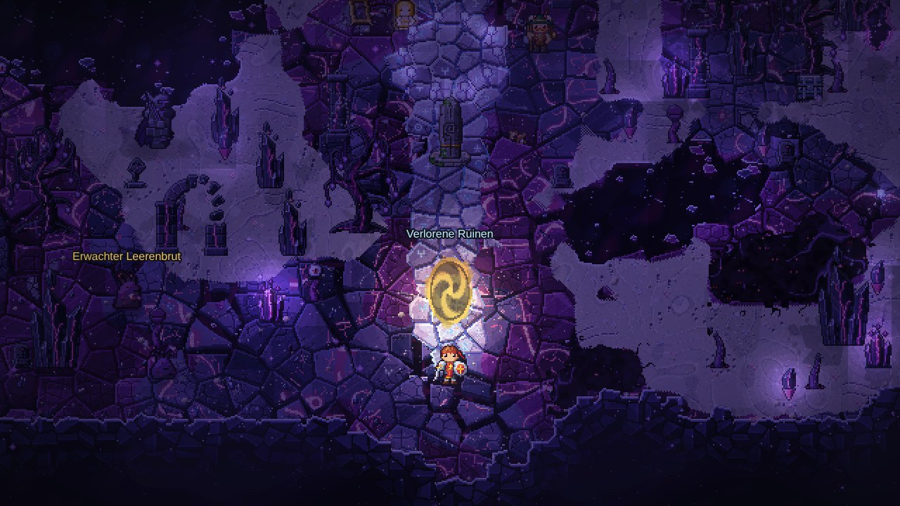 |
| Thron der Leere (Dungeon) | 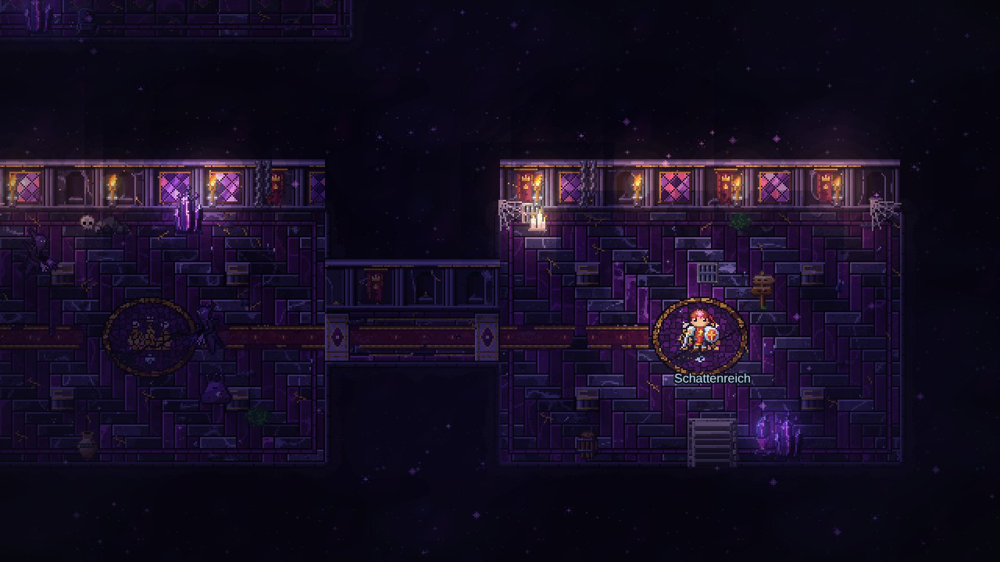 |
| Gletscherdom, Bosskampf gegen Ysolde | 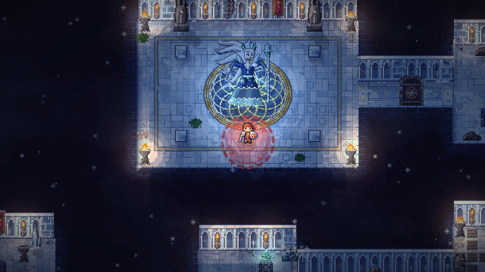 |

Kontaktbögen aller Sprites: `docs/art/chars.png`, `mobs.png`, `bosses.png`, `objects.png`, `fx.png`.

## 3. Ausgetauschte Assets

Sämtliche Grafiken der Version 0.1.0 wurden ersetzt; im Atlas ist kein v1-Frame mehr enthalten
(einzige Ausnahme: der weiche Lichtring `ring` im Effekt-Atlas).

| Gruppe | Alt (0.1.0) | Neu (0.2.0) | Quelle |
|---|---|---|---|
| Figuren (5 Klassen, 15 NPCs) | 24×32, 16 Spalten, 3–4 Animationen | 32×40, 43 Spalten × 3 Blickrichtungen: Idle, Gehen, Laufen, Angriff, schwerer Angriff, Ausweichen, Treffer, Zaubern, Interagieren, Tod | `gfx/chars/` |
| Gegner (25) | 7 Frames, 24–32 px | 22 Frames (Idle, Bewegung, Ankündigung, Angriff, Treffer, Tod), 32–56 px | `gfx/mobs/` |
| Bosse (6) | 9 Frames, 64–96 px | 26 Frames inkl. Spezial- und Todesanimation, 96–128 px | `gfx/bosses/` |
| Gelände (6 Biome + 6 Dungeons) | ein gemeinsamer Kachelmaler, Wandfront 1 Kachel | ein Maler je Biom, mehrschichtiger Boden, Wandfronten bis 2 Kacheln, Uferböschungen, Brücken mit Geländer, raumbezogene Dungeonböden | `gfx/tiles/` |
| Flüssigkeiten | 4 Frames à 32×32 | 8 Frames à 64×64 je Biom | `gfx/tiles/*_liquid.ts` |
| Objekte | 131 Frames | 550 Frames: Vegetation mit Wiegeanimation, Dorf, Lager je Biom, Dungeon-Ausstattung, interaktive Objekte mit Zwischenzuständen, 25 Kleintierarten | `gfx/objects/` |
| Effekte | 43 Frames, überwiegend Einzelbilder | 318 Frames in 90 Effekten: Waffenspuren je Klasse, Treffer, Geschosse und Explosionen je Element, Zauber, Zustände, Wetter, Marker | `gfx/fx2/` |
| Overlays | – | Nebel, Wolkenschatten, Blätterschatten | `gfx/fx2/overlays.ts` |
| Icons | 318 Icons (unverändert übernommen, jetzt als Atlas exportiert) | – | `gfx/icons.ts` |

Neu in der Engine (keine Assets, aber sichtbar): dynamische Schlagschatten, Lichtkarte mit farbigen Lichtern und
Tagesverlauf, ausblendende Baumkronen, Lichtstrahlen, Schornsteinrauch, Fußspuren im Schnee, Staub beim Laufen,
Treffer-Stopps, Bodenrisse und Brandflecken nach Explosionen.

## 4. Prüfung nach Checkliste

| Frage | Ergebnis |
|---|---|
| Passen alle Assets zusammen? | Ja, soweit geprüft: gemeinsame Palette, gleiche Lichtrichtung, farbige Konturen. Frost und Schattenreich nutzen bewusst kühlere bzw. dunklere Konturen. |
| Stimmen die Größenverhältnisse? | Figur ≈ 2 Kacheln, große Bäume 5–6 Kacheln, schwere Gegner 38–42 px, Bosse 96–128 px. Auffällig klein: Haustüren (≈ 23 px bei 28 px Figur), Nomadenzelt. |
| Sind Charaktere gut erkennbar? | Im Grünwald und in hellen Biomen ja. Der Schattenjäger ist auf dunklem Boden kontrastarm. |
| Sind Animationen flüssig? | **Nur eingeschränkt geprüft.** Die Prüfung erfolgte an Einzelbildern und Animationsstreifen; die Umgebung hier kann keine Bewegung betrachten. Framezahlen und Raster sind korrekt, der Eindruck in Bewegung muss am Bildschirm bestätigt werden. |
| Sichtbare Wiederholungsmuster? | Boden: keine Kachelwiederholung. Flüssigkeiten: Der 64-px-Rapport ist auf großen Lava-, Wasser- und Leereflächen erkennbar. |
| Ist die Beleuchtung stimmig? | Tag, Nacht, Höhle und Dungeon wurden im Spiel geprüft; Dungeons wurden nach der Prüfung leicht aufgehellt. Dämmerung und Regen wurden nicht einzeln angesehen. |
| Funktionieren alle Sprite-Sheets? | Export prüft jedes Sheet gegen sein Raster (keine Warnung). Alle 51 Sheets und 3 Atlanten laden im Spiel; Browser-Durchlauf ohne Konsolenfehler. |
| Werden die Grafiken korrekt dargestellt? | Ganzzahliger Zoom, Nearest-Neighbour, gerundete Positionen; in den Aufnahmen keine unscharfen Texturen. Geprüft bei 1280×720; andere Auflösungen nur rechnerisch. |

Automatische Prüfungen: 31 Logik- und Servertests, Browser-Durchlauf (`npm run test:e2e`), Nahtlosigkeitstest des
Geländes (0 abweichende Pixel auf allen 12 Karten), Rahmen- und Standflächenprüfung der Sprite-Vorschauen.

## 5. Bekannte Schwächen (ehrlich)

**Prüftiefe.** Der Grünwald wurde in vielen Kritikrunden überarbeitet. Die übrigen Biome, die Gegner und die Bosse
bekamen wegen begrenzten Rechenbudgets nur ein bis drei Runden; Kleintiere, kleine Partikel und Statussymbole wurden
teils nur im Überblick gesehen.

- **Figuren:** Ausweichrolle und Liegeframes sind gedrehte Posen (von vorn/hinten ungewohnt); Schläge nach oben sind
  großteils vom Körper verdeckt; Stäbe und Hämmer folgen dem Gehwippen nicht; alle Gesichter teilen eine Grundform.
- **Gegner:** Einige Frames berühren den Framerand (Dornkäfer, Golem, Ritter – nicht pixelgenau auf Beschnitt geprüft);
  mehrere Todesanimationen nutzen dasselbe Zerbrech-Muster; Schnee-Gegner sind auf Schnee kontrastarm.
- **Bosse:** Hohler König mit steifem Schwertarm und glockenförmiger Silhouette; letzte Todesframes bei vier Bossen fast
  unverändert; Ysoldes Zersplittern besteht aus eckigen Stücken.
- **Gelände:** Schneeplateaus heben sich an Nord- und Westkanten nur mäßig ab; die Mittelrille der Ruinenstraße zerfasert
  an Kreuzungen; Felsfronten im Grünwald wirken eher gemauert als gewachsen; im Schattenreich ragen Uferplatten optisch
  bis zu 9 px über die begehbare Fläche hinaus.
- **Objekte:** Verkohlte Büsche und Stümpfe gehen auf dunkler Schlacke fast unter; Farn und einfacher Busch im Grünwald
  sind die schwächsten Pflanzen; `void_rift` flackert statt zu fließen.
- **Effekte:** Windexplosion ist auf Gras kontrastarm; Levelaufstiegs-„Flügel“ sind klein; getönte Waffenspuren können
  etwas stumpf wirken.
- **Nicht umgesetzt:** Hitzeflimmern als Bildverzerrung (stattdessen Glutpartikel und Lichtschein), animierte Blätter
  über Wiegeframes hinaus, Interaktionsanimation fremder Spieler (nur die eigene Figur zeigt sie).

## 6. Werkzeuge

Bildgenerierung, Aseprite, Tiled und TexturePacker standen in der Entwicklungsumgebung nicht zur Verfügung. Die Assets
entstanden als Zeichenprogramme und werden in die Formate dieser Werkzeuge exportiert (Aseprite-JSON, TexturePacker-JSON,
Tiled-Karten), sodass sie dort geöffnet und von Hand weiterbearbeitet werden können.
